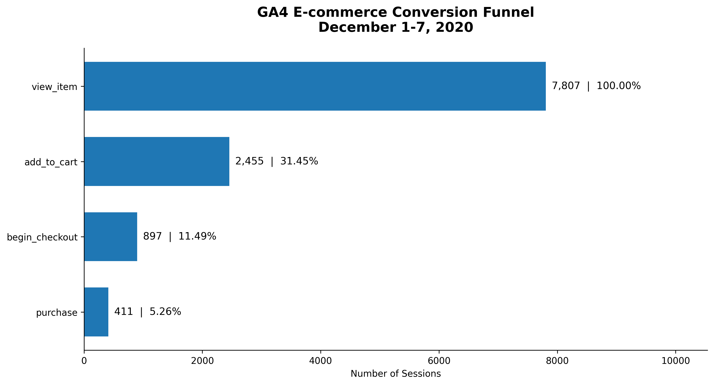
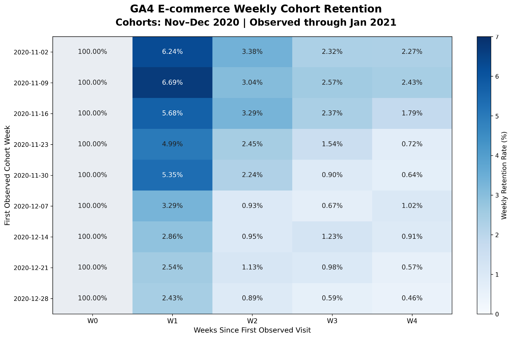
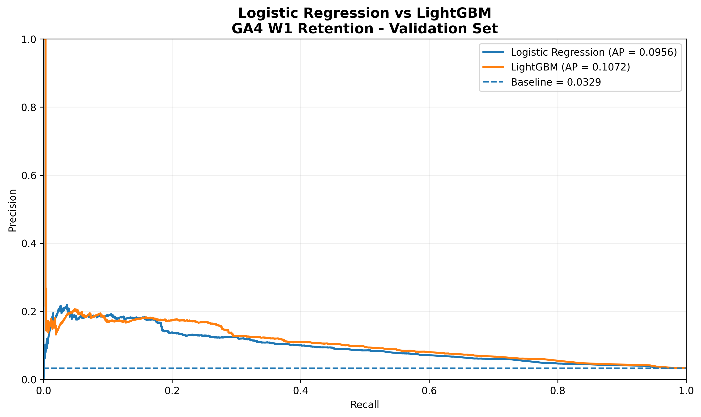
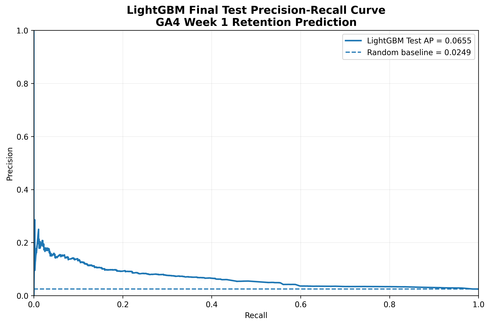
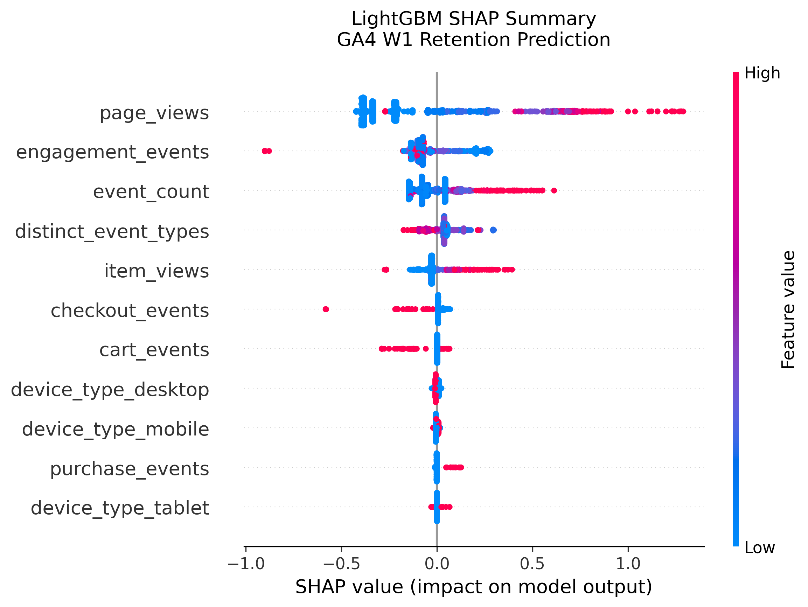
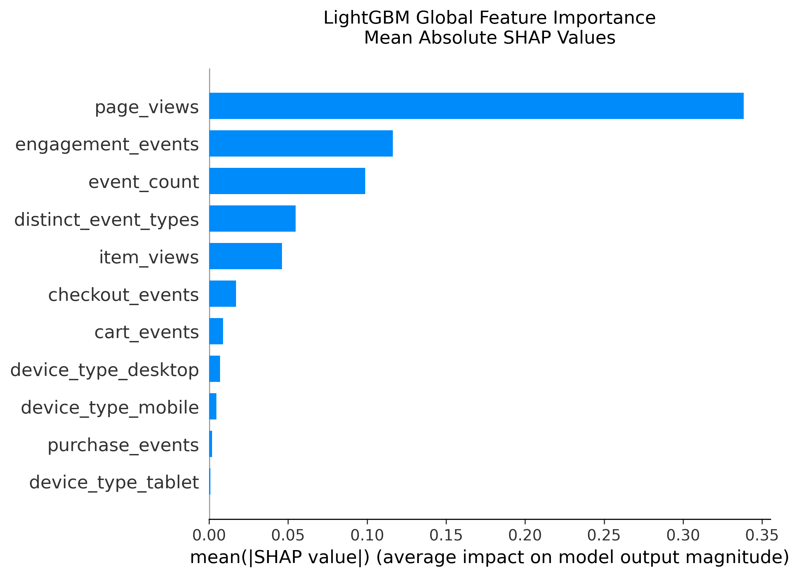
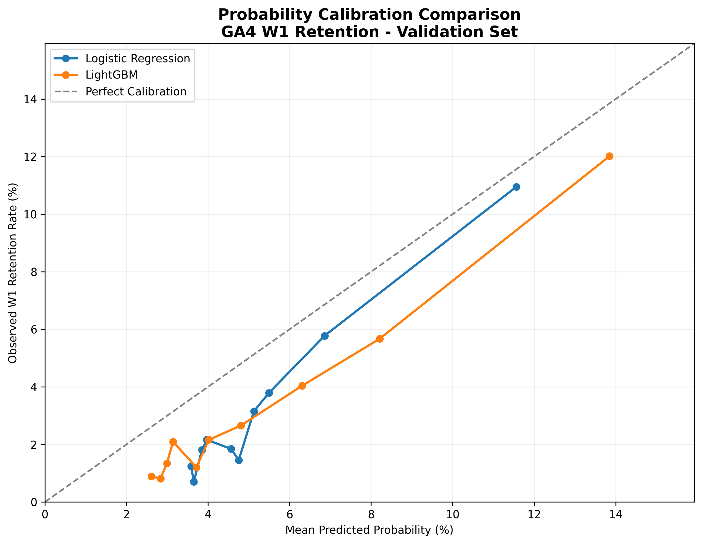
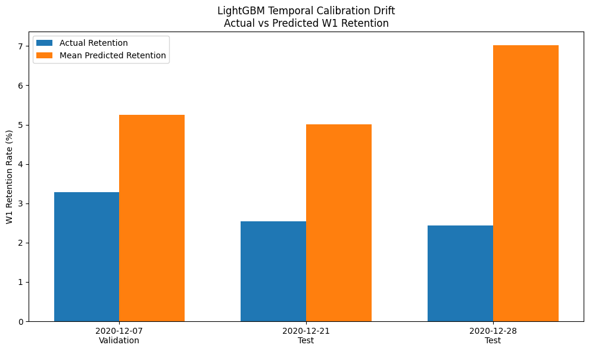

# GA4 E-commerce Analytics: Conversion Funnel, Cohort Retention & Predictive Modeling

**SQL + Python | Google BigQuery · Pandas · scikit-learn · LightGBM · SHAP · Plotly**
### Live Interactive Dashboard

[View the GA4 Retention & Model Monitoring Dashboard](https://xinhaidi021005-sudo.github.io/GA4-Ecommerce-Analytics/dashboard/GA4_Model_Monitoring_Dashboard.html)

Explore cohort retention trends, behavioral feature drift, actual vs. predicted retention, and model performance through interactive Plotly visualizations.
An end-to-end analytics portfolio project built on **Google's public, obfuscated GA4 e-commerce sample dataset**. The analysis connects a sequential shopping funnel, weekly customer return cohorts, and a first-session retention prediction model—then examines how model performance changes across time.

> **Project status:** Exploratory analysis, feature engineering, explainability, and holdout evaluation completed. The prediction model is a **research prototype**, not a production-ready targeting or probability-estimation system. This is an independent portfolio project, not work commissioned by Google or an e-commerce operator.

## At a glance

| Business / modeling result | Observed value |
|---|---:|
| Pseudonymous identifiers in eligible retention cohorts | **181,360** |
| Sequential item-view → purchase conversion, Dec 1–7, 2020 | **5.26%** |
| Overall W1 weekly return | **4.36%** |
| W1 return: November vs December 2020 cohorts | **5.74% → 2.85%** |
| LightGBM validation ROC-AUC | **0.7420** |
| LightGBM final test ROC-AUC | **0.6802** |
| LightGBM final test AP / Lift@5% | **0.0655 / 3.74×** |

**Explore the deliverables:** [BigQuery SQL](sql/) · [Python modeling notebook](notebooks/GA4_Retention_Modeling_GitHub_Ready.ipynb) · [Interactive monitoring dashboard (HTML)](dashboard/GA4_Model_Monitoring_Dashboard.html) · [All figures](figures/)

## Business questions

1. Where do sessions drop out of the ordered item-view → add-to-cart → checkout → purchase journey?
2. How do weekly return rates vary by first-observed cohort, device, and acquisition attribution?
3. Are November-to-December retention changes associated primarily with group mix or with changes within groups?
4. Which features from a user's first **observed** session are predictive of a return the next calendar week?
5. Does a model chosen on earlier cohorts remain accurate and calibrated on later cohorts?

## Analytics workflow

```text
Google GA4 public event tables (BigQuery)
            |
            +--> SQL event extraction / UNNEST / ordered session funnel
            |        \--> conversion analysis
            |
            +--> first-observed weekly cohorts
            |        \--> W1-W4 return, device and channel decomposition
            |
            +--> first-observed-session feature table (181,360 rows)
                     |
                     v
            Python: quality checks and chronological splitting
                     |
          Logistic Regression vs LightGBM
                     |
             SHAP feature interpretation
                     |
          Calibration + temporal drift diagnostics
                     |
          Static plots + interactive Plotly dashboard
```

## 1. E-commerce conversion funnel

A **session-level, sequential** funnel was constructed for **December 1–7, 2020**, requiring the events to occur in stage order within a session.

| Funnel stage | Qualifying sessions | Share of item-view sessions |
|---|---:|---:|
| View item | 7,807 | 100.00% |
| Add to cart | 2,455 | 31.45% |
| Begin checkout | 897 | 11.49% |
| Purchase | 411 | **5.26%** |

The largest proportional loss was between **item view and add to cart (68.55%)**. This identifies where to investigate the experience; it does not establish why visitors abandoned the journey. The 5.26% figure is **not** an all-site purchase conversion rate.



**SQL:** [`05_conversion_funnel.sql`](sql/05_conversion_funnel.sql)

## 2. Weekly cohort retention

The cohort analysis uses the first week in which an identifier is **observed** triggering `session_start` in the available data. W1–W4 represent **returns in particular later calendar weeks**, not uninterrupted weekly retention.

The **cohorts start in November–December 2020**; the W4 follow-up observation window extends into **January 2021**. The heatmap title distinguishes cohort formation dates from subsequent observation dates.

For nine eligible weekly cohorts (181,360 pseudonymous identifiers), the **weighted** weekly return rates were:

| Week | W1 | W2 | W3 | W4 |
|---|---:|---:|---:|---:|
| Observed return rate | **4.36%** | **1.95%** | **1.40%** | **1.17%** |

Weighted W1 return fell from approximately **5.74%** for November cohorts to **2.85%** for December cohorts, a decline of about **2.89 percentage points**.



In descriptive device and acquisition-channel decompositions, changes **within** groups accounted for nearly all of the net decline, while changes in observed group shares contributed relatively little. The acquisition analysis is especially limited because approximately **31%** of identifiers were unattributed or obfuscated. These decompositions are **not causal attribution**.

**SQL:** [`12_cohort_retention.sql`](sql/12_cohort_retention.sql) · [`14_device_retention.sql`](sql/14_device_retention.sql) · [`16_cohort_device_retention.sql`](sql/16_cohort_device_retention.sql) · [`19_acquisition_channel_retention.sql`](sql/19_acquisition_channel_retention.sql)

## 3. First-session retention prediction

### Problem definition and feature engineering

The binary target, `returned_w1`, indicates whether a `session_start` occurred in the **following calendar week**. The BigQuery feature table contains **181,360 rows**, one per pseudonymous identifier, with **8 numerical first-observed-session behavior features** plus first-observed device type.

The Python workflow uses a **chronological split with gap cohorts**, avoiding training on next-week outcomes that would not yet have been observable at the intended prediction time.

| Split | Cohort periods | Users | W1 return rate |
|---|---|---:|---:|
| Train | Nov 2–23, 2020 | 72,855 | 5.86% |
| Validation | Dec 7, 2020 | 28,221 | 3.29% |
| Test | Dec 21–28, 2020 | 33,752 | 2.49% |

The Nov 30 and Dec 14 cohorts were held out as **observation gaps**. The validation set was used for early stopping/model selection; the later holdout test was evaluated once for final reporting.

**SQL:** [`21_first_session_feature_audit.sql`](sql/21_first_session_feature_audit.sql) · [`23_user_retention_features.sql`](sql/23_user_retention_features.sql)

**Python:** [`GA4_Retention_Modeling_GitHub_Ready.ipynb`](notebooks/GA4_Retention_Modeling_GitHub_Ready.ipynb)

### Model comparison

| Metric | Logistic Regression (validation) | LightGBM (validation) | LightGBM (final test) |
|---|---:|---:|---:|
| Random-ranking / class-prevalence baseline | 3.29% | 3.29% | 2.49% |
| Average Precision (AP) | 0.0956 | **0.1072** | 0.0655 |
| ROC-AUC | 0.7172 | **0.7420** | 0.6802 |
| Precision@5% | 13.60% | **16.78%** | 9.30% |
| Recall@5% | 20.69% | **25.54%** | 18.69% |
| Lift@5% | 4.14× | **5.10×** | 3.74× |

LightGBM outperformed regularized Logistic Regression on the validation cohort. On later test cohorts, both discrimination and Top-5% enrichment declined: test Precision@5% was **9.30%**, compared with **2.49%** overall W1 return, for a **3.74×** lift. This is evidence of an **observational ranking signal**, not proof that outreach to high-scoring users would improve retention.

**Validation PR curves**



**Final test PR curve**



### SHAP explainability

In the fitted LightGBM model, `page_views`, `engagement_events`, and `event_count` had the largest average absolute SHAP contributions. Page browsing depth was an important predictor, but SHAP values explain **model predictions rather than causal effects**. Correlated behavior measures also complicate individual-feature interpretation.

**SHAP units:** The binary LightGBM explanations were computed with `shap.TreeExplainer(model_output="raw")`. Accordingly, the summary plot displays changes in the model’s **raw log-odds output**, and the importance bars show **mean absolute SHAP values in log-odds units**. These are **not** percentage-point changes in observed retention or predicted probability.





## 4. Model reliability and temporal drift

The model's **absolute probability estimates were systematically high** on the evaluation cohorts:

| Cohort / split | Actual W1 return | Mean LightGBM prediction | Overprediction |
|---|---:|---:|---:|
| Validation (Dec 7) | 3.29% | 5.25% | +1.96 pp |
| Test (Dec 21) | 2.54% | 5.00% | +2.46 pp |
| Test (Dec 28) | 2.43% | 7.02% | +4.58 pp |

Test-set **ECE was approximately 0.0350** using 10 equal-frequency bins, compared with approximately **0.0196** on validation. ECE is binning-dependent and is presented as a diagnostic, not a universal calibration score.





Between train and test cohorts, average `page_views` fell approximately **38%**, `engagement_events` **53%**, and `item_views` **61%**. These shifts are credible monitoring signals, but they do not by themselves prove the source of the model degradation.

**Practical conclusion:** the current LightGBM model may support exploratory **ranking** of likely returners, but should **not** be deployed as a calibrated individual-level return-probability system without additional validation and monitoring.

## 5. Interactive monitoring dashboard

The Plotly dashboard brings together weekly cohort retention, train-to-test feature changes, actual versus predicted return rates, and validation-versus-test Average Precision.

**[Open the standalone dashboard HTML](dashboard/GA4_Model_Monitoring_Dashboard.html)** (download or open the file in a browser). This is a saved **interactive snapshot**, not a live production dashboard.

## Repository structure

```text
GA4-Ecommerce-Analytics/
├── README.md
├── requirements.txt
├── sql/
│   ├── 05_conversion_funnel.sql
│   ├── 12_cohort_retention.sql
│   ├── 14_device_retention.sql
│   ├── 16_cohort_device_retention.sql
│   ├── 19_acquisition_channel_retention.sql
│   ├── 21_first_session_feature_audit.sql
│   └── 23_user_retention_features.sql
├── notebooks/
│   └── GA4_Retention_Modeling_GitHub_Ready.ipynb
├── figures/             # 8 exported PNG figures (linked above)
├── dashboard/
│   └── GA4_Model_Monitoring_Dashboard.html
├── data/                # Vetted aggregate exports only; may be empty
└── reports/             # Optional report deliverables; may be empty
```

*Note: Git does not track empty folders. `data/` and `reports/` will only appear on GitHub after they contain a tracked file.*

## How to reproduce

1. Prepare a Google Cloud project and **US-region** BigQuery dataset. The source is the public `bigquery-public-data.ga4_obfuscated_sample_ecommerce` GA4 event sample.
2. Examine and run the relevant scripts in [`sql/`](sql/). Adapt hard-coded project/table identifiers, verify dataset locations and dependencies, and inspect BigQuery's estimated query cost before execution. The modeling Notebook expects a resulting `ga4_analytics.user_retention_features` table.
3. Open [`notebooks/GA4_Retention_Modeling_GitHub_Ready.ipynb`](notebooks/GA4_Retention_Modeling_GitHub_Ready.ipynb) in **Google Colab**. Install dependencies using [`requirements.txt`](requirements.txt) or the notebook's installation cells.
4. Authenticate interactively with `google.colab.auth.authenticate_user()` and configure the `PROJECT_ID`, `DATASET_ID`, and `TABLE_ID` references for your own environment. Credentials are **not** included in this repository.
5. Run feature validation, temporal splitting, modeling, SHAP, calibration, and monitoring cells in sequence. The notebook deliberately clears stored execution output to avoid publishing user-level identifiers; output images are available under [`figures/`](figures/).
6. To reproduce the cohort retention heatmap, run sql/12_cohort_retention.sql in BigQuery, export the query results as ga4_cohort_retention.csv, and upload the CSV when prompted by Step 40 in the notebook.

**Reproducibility limitation:** The provided notebook is designed to run against an accessible BigQuery feature table. It does **not** bundle raw event data, cloud access permissions, or a fully automated deployment pipeline.

## Caveats and responsible interpretation

- The Google sample is **historical and obfuscated**; no conclusions here represent contemporary commercial operations.
- A `user_pseudo_id` is a pseudonymous client identifier, **not a guaranteed unique person**. The first **observed** session is not necessarily the person's first-ever session.
- W1–W4 indicators describe observed `session_start` events in later calendar weeks and do not mean continuous retention.
- Session extraction may miss events before the selected `session_start` or a session crossing a week boundary. Observational associations can reflect tracking behavior, calendar effects, or selection effects.
- The validation sample covers one cohort; rolling-origin validation and a separate, chronologically later calibration/evaluation design would strengthen reliability.
- Do **not** infer causal lift from SHAP explanations or decomposition results. A randomized experiment would be needed to evaluate changes in onboarding or re-engagement campaigns.
- **Privacy:** Never commit raw event exports, pseudonymous user identifiers, credentials, tokens, or notebook outputs containing individual records. Only vetted aggregate data, code, and figures belong in the public repository.

## Further work

- Add rolling temporal backtests across several cohorts and report confidence intervals around ranking metrics.
- Investigate measurement consistency and feature definitions under drift.
- Assess recalibration using separate chronological calibration data and a new untouched test period.
- Validate potential retention interventions through controlled experiments rather than treating prediction as causal evidence.

---

*Independent portfolio analysis using Google's public GA4 sample. No affiliation with or endorsement by Google is implied.*
